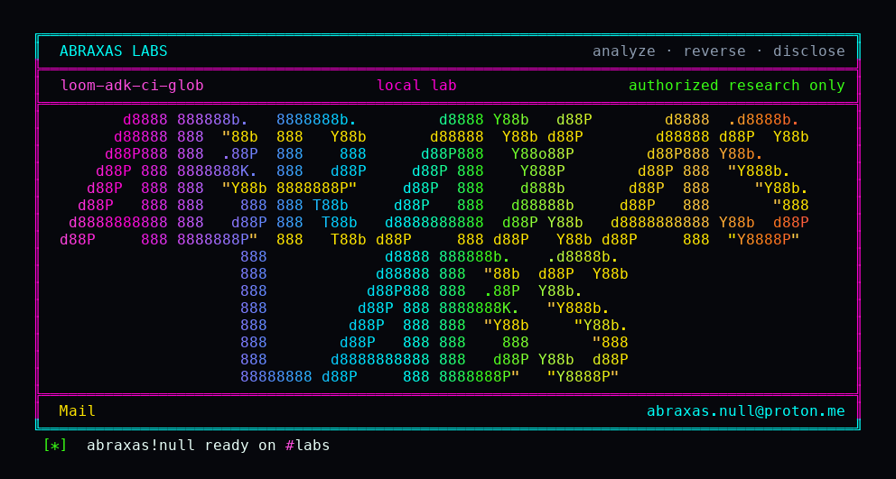

<p align="center">
  
</p>

# loom-adk-ci-glob

An approval rule written as the exact name `code_interpreter` pauses the Strands tool of that name. It does not pause the ADK tools that execute code and commands. Those tools are named `code_interpreter_execute_code` and `code_interpreter_execute_command`. Empty rules, `*`, and `code_interpreter*` still match both.

This is the matcher. The lab did not start a shell on the host or in the sandbox. The score is the missed gate on those two tools. Bedrock Guardrails are a different feature and are not this bug.

**Class:** Approval pattern does not match the tool name
**Reach:** Remote. In-group `invoke` on an ADK agent with the code interpreter enabled, where an operator added a `require_approval` rule named `code_interpreter`.

**[Loom](https://github.com/awslabs/loom)** [v1.9.0](https://github.com/awslabs/loom/releases/tag/v1.9.0) `a3050669` and [v1.10.3](https://github.com/awslabs/loom/releases/tag/v1.10.3) `cc10ab0`

| | |
|---|---|
| ID | no CVE yet |
| Class | **Exact `code_interpreter` rule misses ADK execute tools** |
| Reach | **Remote**, in-group `invoke` |
| CWE | [CWE-862](https://cwe.mitre.org/data/definitions/862.html) |
| CVSS | **High: 7.1** `CVSS:3.1/AV:N/AC:L/PR:L/UI:N/S:U/C:L/I:H/A:N` |
| Product | [awslabs/loom](https://github.com/awslabs/loom) |
| Affected | **v1.9.0** `a3050669f5b4c83210a44ed4346f17e01641e82f` and **v1.10.3** `cc10ab08573087fa12154f7c8181ffcd985fea88` |
| Auth | `invoke` |
| License | [GNU Affero GPL v3.0](LICENSE) |
| Lab | loopback Docker on v1.9.0. Matcher source-checked on v1.10.3. |

`C:L` is the sandbox file tools under the same prefix, not a host read. The oracle did not call them.

## What an attacker can do

| Rule | Strands `code_interpreter` | ADK `execute_code` / `execute_command` |
|---|---|---|
| Exact `code_interpreter` | pause (lab: matches) | **no match** (lab) |
| `*` | pause | pause (lab) |
| empty rule list | pause | pause (lab). Empty means match. |
| `code_interpreter*` | pause | pause (lab) |

**Stays closed**

| Axis | Rule | Why it is closed |
|---|---|---|
| Integrity | `*`, empty, `code_interpreter*` | Still match the ADK names |
| Integrity | Strands exact name | Still matches |
| Integrity | Guardrail configuration | Not this matcher |

ADK also registers write, read, list, and remove file tools with the `code_interpreter_` prefix. The lab's yes/no results are the two execute names.

## How I found it

`_matches_tool` is `fnmatch`. I put the Strands name in a rule and asked it about the ADK names. `fnmatch` does not treat `code_interpreter` as a prefix. The ADK module registers `code_interpreter_execute_code` at the top of its tool list.

Container on v1.9.0. The same `fnmatch` and the same function name are on v1.10.3. I did not rebuild the container.

## Lab

```bash
python3 loom-adk-ci-glob-Abraxas-Labs.py
```

```text
SUCCESS LOOM-190-ADK-CI-GLOB strands-name-matches=yes adk-execute-code-matches=no adk-execute-command-matches=no star-matches-adk=yes empty-matches-adk=yes glob-star-matches-adk=yes LOOM-190-ADK-CI-GLOB-WITNESS
```

## The fix

Match on the prefix the ADK tools actually use, or register an alias the existing rule already names. An exact Strands name should not be the only pattern the UI offers for "pause code execution."

## References

- [awslabs/loom v1.10.3](https://github.com/awslabs/loom/releases/tag/v1.10.3) `cc10ab08573087fa12154f7c8181ffcd985fea88`
- [`approval.py` `_matches_tool`](https://github.com/awslabs/loom/blob/cc10ab08573087fa12154f7c8181ffcd985fea88/agents/adk_agent/src/integrations/approval.py#L56)
- [`code_interpreter.py`](https://github.com/awslabs/loom/blob/cc10ab08573087fa12154f7c8181ffcd985fea88/agents/adk_agent/src/integrations/code_interpreter.py#L97)
- [CWE-862](https://cwe.mitre.org/data/definitions/862.html)
- [CVSS 3.1 calculator](https://www.first.org/cvss/calculator/3.1#CVSS:3.1/AV:N/AC:L/PR:L/UI:N/S:U/C:L/I:H/A:N)


## License

GNU Affero GPL v3.0. See [LICENSE](LICENSE). Loopback lab only. No warranty.

Abraxas Labs
abraxas.null@proton.me
